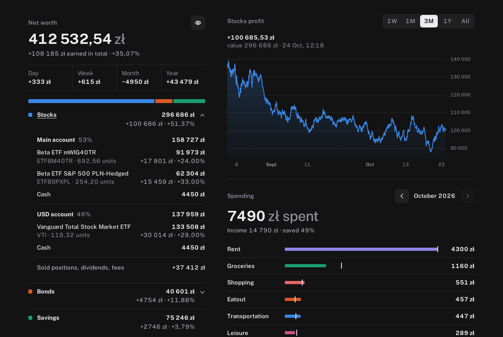

# finance-dashboard

A self-hosted personal-finance dashboard for Poland. It shows net worth with
day/week/month/year earnings, an XTB stock portfolio (per account and
instrument, with a 15-minute profit chart) and Treasury bonds (EDO, TOS, …),
plus monthly spending by category from your bank transactions.



Nothing scrapes websites. Every number comes from an API, a public data feed or
a file you export by hand:

| Source | How | Job |
|---|---|---|
| Bank transactions (any Polish bank Enable Banking supports) | [Enable Banking](https://enablebanking.com) PSD2 API | `banks/fetch_transactions.py` |
| XTB stocks / ETFs | xStation 5 history export (`.xlsx`) + Yahoo Finance prices | `xtb/rebuild_xtb.py` |
| Treasury bonds | a small `bonds.csv` you keep, GUS CPI + NBP reference rate | `gus-cpi/`, `nbp-rates/` |
| Anything else (savings, deposits, …) | your own scripts, kept out of git | `plugins/` |

Two containers: **`finance-jobs`** runs every job on a schedule (supercronic)
and rebuilds `dashboard.json` after each one, and **`dashboard`** (Caddy) serves
a static page on port 2718. The page has no build step and no external
requests, and works well on a phone. It has an "eye" button that hides every
amount (for showing the page to someone).

## Try it with fake data

Needs Docker and Python 3.10+ (for the generator; standard library only).

```sh
cp .env.example .env
python3 demo/make_demo_data.py data          # invented numbers, names and IBANs
docker compose build
docker compose run --rm finance-jobs run-dashboard
docker compose up -d dashboard               # → http://localhost:2718
```

Only the `dashboard` container is started here, so no job overwrites the demo
files. Delete `data/` before switching to real data.

## Set it up for real

See **[docs/SETUP.md](docs/SETUP.md)**: Enable Banking, XTB exports, bonds,
categories, schedules and day-to-day upkeep.

The page has no login. Keep port 2718 on your LAN or behind a VPN
(e.g. a VPN); don't expose it to the internet.

## Licence

MIT, see [LICENSE](LICENSE). The third-party code below keeps its own licence.

## Third-party code

- [TradingView Lightweight Charts](https://github.com/tradingview/lightweight-charts) 4.2.0 (Apache-2.0), vendored in `dashboard/web/vendor/`; the page links back as its licence asks.
- [Public Sans](https://github.com/uswds/public-sans) (SIL Open Font License 1.1), in `dashboard/web/fonts/`.
- Prices from Yahoo Finance's unofficial chart API; CPI from GUS; reference rate and FX from NBP.

This is a personal project, not financial advice. Bond values are
models: check them against your bank and the official statements.
